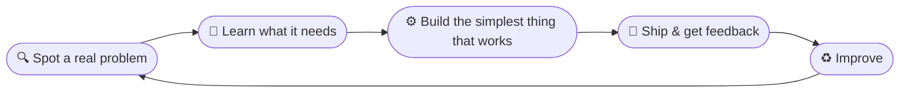

<!-- ═══════════════ HEADER ═══════════════ -->
<div align="center">


<a href="https://github.com/dharanishvijayakumar7-lgtm">
  
</a>

<br/>


<a href="https://linkedin.com/in/dharanish-vijayakumar-a9b112392">
  
</a>
<a href="https://github.com/dharanishvijayakumar7-lgtm?tab=followers">
  
</a>

</div>

<br/>

<!-- ═══════════════ TERMINAL ABOUT ═══════════════ -->
## 🖥️ `whoami`

```bash
dharanish@github:~$ whoami
Dharanish Vijayakumar

dharanish@github:~$ cat about.json
{
  "role"     : "CSE Student & Builder",
  "focus"    : ["AI / ML", "Computer Vision", "Full-Stack Development"],
  "building" : ["Tools for farmers", "Women-safety tech", "Carbon-footprint AI"],
  "style"    : "Impact over complexity",
  "motto"    : "Code. Learn. Build. Repeat. 🚀"
}

dharanish@github:~$ echo $STATUS
🎯 Focusing  |  🏆 Hackathon mode: ON
```

<br/>

<!-- ═══════════════ BUILD LOOP ═══════════════ -->
## 🔁 How I Build



<br/>

<!-- ═══════════════ TECH ═══════════════ -->
## 🧰 Tech Arsenal

<div align="center">

**Languages**<br/>


**Frameworks & Backend**<br/>


**Data & Storage**<br/>


**Dashboards & ML**<br/>


**Tools**<br/>


</div>

<br/>

<!-- ═══════════════ NOW ═══════════════ -->
## 🌱 Right Now

| 🔭 Exploring | 🛠️ Building | 🤝 Open to |
| :--- | :--- | :--- |
| AI/ML & computer vision | Apps that solve everyday problems | Hackathons, teams & collaborations |

<br/>

<!-- ═══════════════ CONNECT ═══════════════ -->
## 📫 Let's Connect

<div align="center">

<a href="https://linkedin.com/in/dharanish-vijayakumar-a9b112392"></a>
<a href="https://github.com/dharanishvijayakumar7-lgtm"></a>
<a href="https://croppilot.onrender.com"></a>

<br/><br/>

<i>"We didn't chase buzzwords. We built what people actually need."</i>


</div>
